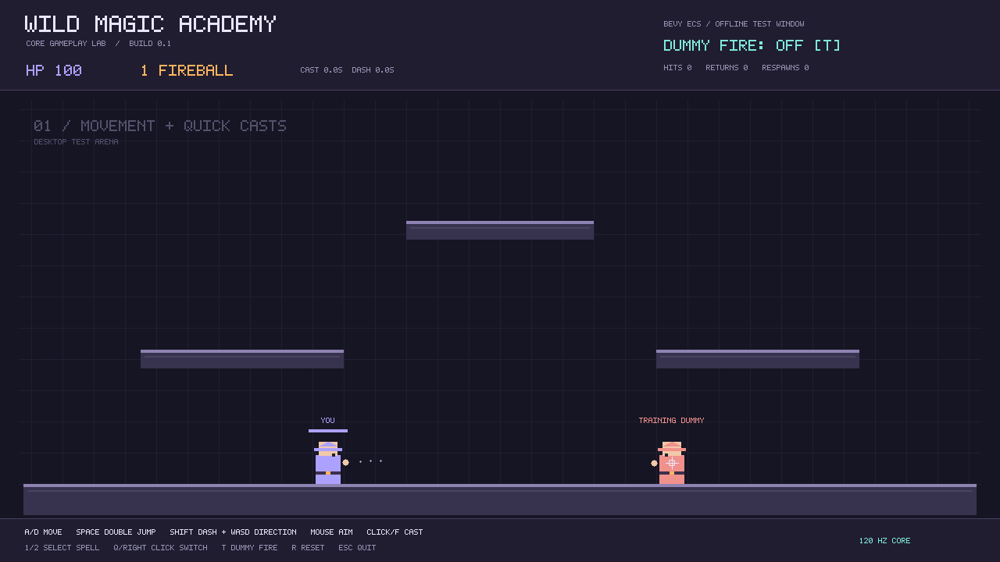

# Wild Magic Academy — core gameplay lab

A fixed-step Bevy ECS 0.18.1 simulation with a local player and a training opponent.
Run, double jump, directional dash, aim, switch between Fireball/Gust, take damage,
and automatically respawn. Placeholder geometry keeps the focus on gameplay.



## Run the verified offline build

Requires Rust 1.89+ and cached dependencies (or an initial online `cargo fetch`).
From this directory:

```sh
./run.sh
```

`run.sh` adds locally installed window libraries to the search path on NixOS and
launches `wild-magic-desktop` through Cargo. It creates a persistent project-local
Cargo cache in `.cache/cargo`, seeded from existing registry archives and index.
It respects an explicitly provided `CARGO_HOME`. No temporary-directory setup is
needed and dependency extraction/downloads do not write through to the source cache.
On other desktop systems the direct command also works:

```sh
cargo run --locked --offline -p wild-magic-desktop
```

If the configured Wayland compositor is unavailable but X11 is accessible, use
`./run.sh --x11`. Use `./run.sh --help` for snapshot and smoke-test options. Unknown
flags and invalid frame counts fail before opening a window.

The desktop runner uses **Bevy ECS for gameplay** and **winit/softbuffer for the
temporary test window**. It does not use Bevy's GPU renderer. The full Bevy
adapter is described below.

| Control | Action |
| --- | --- |
| A/D or left/right arrows | Run |
| Space | Jump; press again for double jump |
| Shift + WASD/arrows | Directional dash; without direction, dash along aim |
| Mouse | Aim |
| Left mouse or F | Quick cast; holding repeats at the spell cooldown |
| 1 / 2 | Select Fireball / Gust |
| Q or right mouse | Switch spell |
| T | Toggle dummy firing toward the player |
| G | Switch the dummy between Fireball and Gust |
| R | Reset arena; dummy firing returns to off |
| Escape | Quit |

The dummy can be pushed and defeated. With firing enabled, it shoots periodically
so Gust returns and dodging can be practiced. It remains stationary otherwise.
For the movement-slow playtest, press G to select dummy Gust, enable firing with T,
and approach within 190 world units. A Gust hit slows running and dashing by 30% for one
second. The status timer appears above the target and on the local HUD. Repeated
hits refresh the timer without stacking strength. Dash duration stays the same,
so a dash spent entirely under the slow travels 30% less distance. Gust first
forces a stronger airborne launch for 0.2 seconds: incoming movement is replaced,
an active dash ends, and steering/jump/dash cannot cancel that initial launch.
Casting remains available. Afterward, normal jump and slowed movement/dash controls
resume. Gust's existing 0.65-second cast cooldown applies.
Losing window focus pauses simulation and clears held inputs.
Short clicks are buffered until a simulation tick, even if released between ticks.
Dash has priority over a simultaneous jump and does not consume that unused jump.
Knockback remains effective while dashing.
Airborne dashes have one charge per flight. Landing on the floor or a platform
restores it; the existing dash cooldown still applies. An upward/diagonal dash
from the ground spends that flight's charge. Horizontal dashes along the ground
remain reusable after cooldown. The HUD shows whether landing is needed.

## Full Bevy presentation adapter

From a desktop terminal with internet access, run the complete download/build/check/launch flow:

```sh
./bevy-playtest.sh
```

It stops on the first failure and records output in `.cache/logs/bevy-playtest.log`.
Compilation, adapter tests and Clippy must pass before it opens the game. Follow
`PLAYTEST.md` in the window and record the observed results separately.

`bevy-desktop/` is a separate Cargo package pinned to Bevy 0.18.1. It drives the
same core and uploads the placeholder preview into a Bevy sprite. This is an
intermediate adapter, not the final sprite/animation implementation.

```sh
./run.sh --bevy
```

For two-player LAN, use `./run.sh --bevy --host` on the host and
`./run.sh --bevy --join HOST_IP` on the other computer. Use `127.0.0.1` to test
two windows locally. See [multiplayer](../multiplayer/README.md) for network setup,
protocol, verification and current latency/device limits. LAN simulation continues
when unfocused, while local controls clear. R/T/G remain practice-only.

**Build and startup verified:** Bevy 0.18.1 and its dependencies are downloaded
and locked. The adapter compiles, its three tests pass, and strict Clippy passes.
It opened a window on NVIDIA GeForce GTX 1650 through Vulkan (driver 595.71.05).
Wayland runtime loading avoids a build-time pkg-config requirement; the launcher
adds installed Vulkan/OpenGL driver paths on NixOS. Human gameplay feel checks
remain pending. The package stays separate from the offline test workspace.

## Organization

- `src/lib.rs`: simulation initialization, fixed schedule and presentation snapshots.
- `src/model.rs`: actor, input, projectile, arena and diagnostic data.
- `src/systems.rs`: timers, respawn, dummy input, aim/switch, movement, casting,
  projectile collision, damage and defeat; executed in that order.
- `src/collision.rs`: swept solid-platform and projectile collision helpers.
- `src/tuning.rs`: movement, spell, health and timing values.
- `src/client.rs`: shared pending input and bounded frame-to-tick clock.
- `desktop/`: offline window/input adapter and disposable placeholder drawing.
- `bevy-desktop/`: compiled and startup-verified full Bevy window/renderer adapter.
- `tests/gameplay.rs`: behavioral regression and combat soak tests.

Simulation uses 120 ticks/second, world Y increases upward, and player collision
bounds are 32 × 54 world units centered on `Body.position`. Input edges remain
queued until the next tick; held cast repeats only when cooldown permits.

## Checks

```sh
./check.sh
./run.sh --snapshot .cache/preview.ppm
./run.sh --smoke 120
```

`check.sh` runs formatting, tests, strict Clippy, and snapshot generation with no
display required. `--smoke` opens a window, presents
the requested number of frames, and exits; use it in a desktop session. Window
initialization/presentation failures and early interruption return a nonzero exit
code. Minimized zero-size surfaces do not count as presented frames. The window
runner limits redraws to approximately 60 Hz.

All 58 tests pass: 48 gameplay cases, five frame/input cases and five desktop
CLI/render cases, including 12,000 simulation ticks of repeated combat. The
desktop runner builds and produces a reviewed
1280 × 720 snapshot. The full Bevy adapter also passes three tests and strict
Clippy and launches successfully through approved desktop access. Ordinary
sandbox execution still cannot access the display. Human playtesting is still
required; automated tests and window startup do not establish gameplay feel.

## Current boundaries and provisional rules

- Practice mode has one local player and a dummy. The separate LAN session
  replaces the dummy with a real remote player and resolves combat on the host.
  Touch controls and mobile packaging remain later work.
- Static whole-arena camera and solid rectangular platforms. No pit, breakables,
  slopes, moving platforms, actor-on-actor collisions or final courtyard layout.
- Both spells are always available. Shared cast cooldown prevents switch spamming.
- Gust launch strength is 850 with at least 500 upward speed and a 0.2-second
  forced ballistic phase. It replaces incoming run/dash/fall/old knockback velocity
  so moving toward the caster cannot weaken the launch. Terrain blocks travel.
  It affects
  only targets within a forward cone (dot threshold 0.35), range 190, and reflects incoming
  projectiles toward the original caster's current position. It changes the current
  owner to the reflector. Provisional counter-return rule: if the Gust caster is
  also the original projectile caster, target the previous owner instead of
  directing the projectile back at themself. Scoring remains outside this milestone.
- Gust applies a temporary run/dash-speed multiplier of 0.70 for 1.0 second, configured
  in tuning. No direct damage or additional immunity window is added. Protection
  blocks the slow; defeat and respawn clear it.
- Fireball blasts use radial distance to actor bounds without wall occlusion or
  damage falloff. The current owner takes 35% self damage. These are test rules.
- Defeat clears projectiles owned by or originally cast by the defeated actor.
  Respawn restores health, both spells, cooldowns and a protected fixed spawn;
  attacking ends protection. Dynamic safe-spawn selection remains future work.
- No charging, overcasting, fusion, mana, pickups, passive healing, score or match UI.

Input movement is clamped; nonfinite movement/aim is replaced with safe values.
Initial tuning rejects nonfinite/negative parameters and zero tick/health/respawn
intervals. Health bars and the tick-rate label read the actual tuning values.

See [PLAYTEST.md](PLAYTEST.md) and [INTEGRATION.md](INTEGRATION.md) before expanding.
